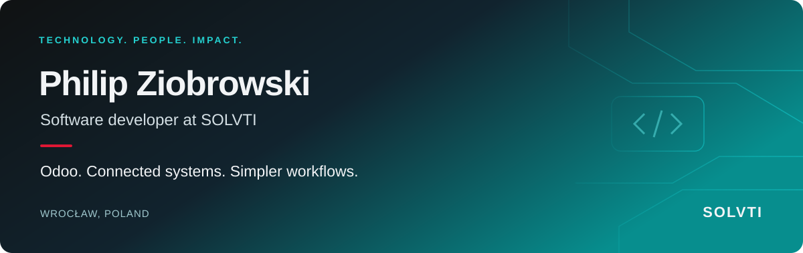

## Turning business complexity into practical software.

I'm **Philip**, a software developer at **[Solvti](https://solvti.com)** in Wrocław, Poland. I work on Odoo ERP, custom modules and integrations — making business systems easier to use, extend and maintain.

### What I work on

- **Odoo development** — adapting business workflows with custom modules and thoughtful interfaces.
- **Connected systems** — integrations that reduce manual work and keep information flowing.
- **Code quality** — implementation, code review and testing, with an emphasis on maintainability.

### The bigger picture at Solvti

Solvti helps companies bring order to their operations through **Odoo implementations, custom development and integrations**. The focus is simple: technology that supports the business, not the other way around.

**Odoo ERP** · **Business automation** · **Integrations** · **AI for business**

---

**Practical software. Connected processes. Real business impact.**

[Explore Solvti →](https://solvti.com) &nbsp; · &nbsp; [Get in touch →](mailto:philip.ziobrowski@solvti.com)
